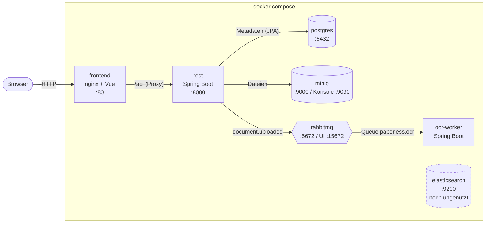
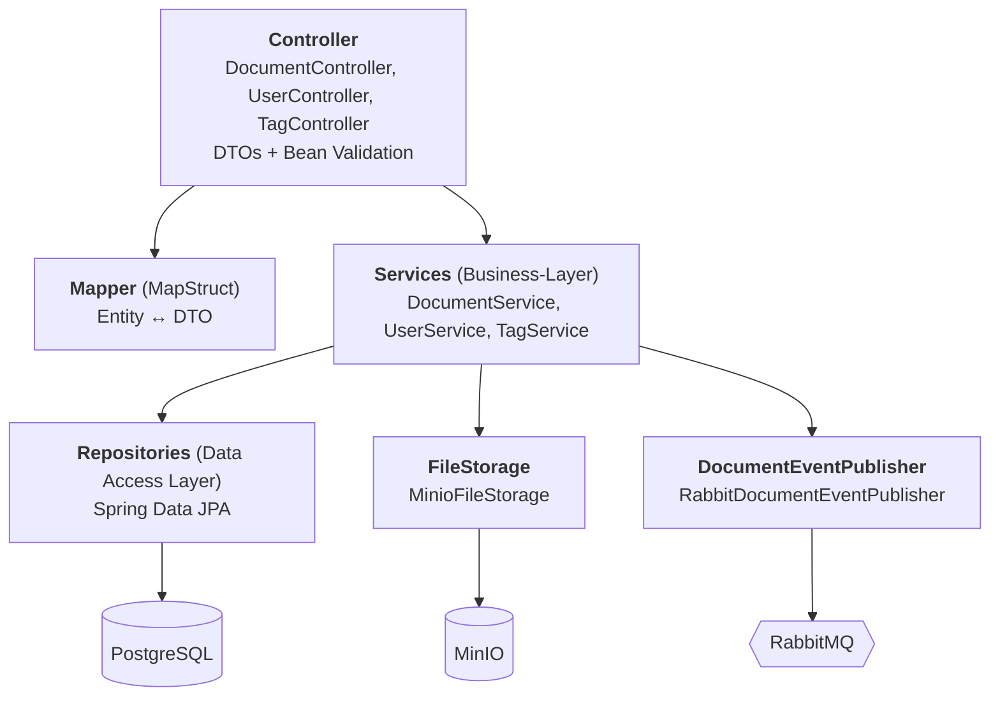

# Projekt Paperless

Document Management System mit Spring Boot Backend und Vue.js Frontend.

Geplanter Funktionsumfang:
- Dokumente hochladen, per OCR auslesen und in der Datenbank speichern
- Automatische Zusammenfassung jedes Dokuments mit Generativer AI
- Volltextsuche über Elasticsearch
- Jeder User kann im Frontend seine Dokumente ansehen und verwalten

## Architektur / Technologien
**Backend:** Java 25, Spring Boot 4, Spring Data JPA, PostgreSQL, MapStruct (Mapping Entity ↔ DTO), MinIO (Datei-Speicher), RabbitMQ (Spring AMQP)
**OCR-Worker:** eigene Spring-Boot-Anwendung in `/ocr-worker`, bekommt die hochgeladenen Dokumente über RabbitMQ
**Frontend:** Vue.js + nginx
**Geplant:** OCR mit Tesseract, Elasticsearch, Google Gemini

### Komponenten
Alle Dienste laufen als eigene Container in `docker-compose.yaml`:



### Schichten im REST-Server


- **Controller** nehmen DTOs entgegen, validieren sie (`@Valid`) und geben DTOs zurück. Entities verlassen den REST-Server nie.
- **Services** enthalten die Geschäftslogik und arbeiten mit Entities.
- **Repositories** kapseln den Datenbankzugriff (Repository Pattern mit Spring Data JPA).
- **Service Agents** (`FileStorage`, `DocumentEventPublisher`) kapseln die externen Systeme. Die Services kennen nur die Interfaces, die Implementierungen für MinIO und RabbitMQ werden per Dependency Injection eingesetzt.

## Messaging (RabbitMQ)
Nach einem erfolgreichen Upload schickt der REST-Server ein Event an RabbitMQ, der OCR-Worker verarbeitet es asynchron:

```
REST ── document.uploaded ──▶ Exchange paperless.documents (topic) ──▶ Queue paperless.ocr ──▶ OCR-Worker
                                                                         │ nicht verarbeitbar
                                                                         ▼
                                                                     Queue paperless.ocr.dlq
```

- **Publish/Subscribe:** Der REST-Server kennt nur den Exchange und den Routing-Key, nicht die Empfänger. Jeder Dienst hat seine eigene Queue, weitere Worker (z. B. GenAI) können später ohne Änderung am REST-Server angebunden werden.
- **Competing Consumers:** Mehrere Instanzen des OCR-Workers teilen sich eine Queue, jede Message wird nur einmal verarbeitet (`docker compose up --scale ocr-worker=3`).
- **Message:** JSON (`documentId`, `ownerId`, `title`, `fileName`, `contentType`, `fileSize`, `storageKey`, `uploadedAt`), damit der Worker die Datei später direkt aus MinIO laden kann.
- **Fehler:** Ist RabbitMQ beim Upload nicht erreichbar, wird der Upload zurückgerollt (Datei wird aus MinIO entfernt) und der Client bekommt `503`. Messages, die der Worker nicht verarbeiten kann, landen in der Dead Letter Queue `paperless.ocr.dlq` statt endlos neu zugestellt zu werden.
- Exchange und Queues werden von REST-Server und Worker gleich deklariert, die Startreihenfolge ist egal. Die Namen sind in beiden `application.properties` unter `paperless.messaging.*` konfiguriert.

In Sprint 3 ist der Worker noch "leer": er loggt die empfangene Message, die OCR folgt in Sprint 4.

## Fehlerbehandlung
Jede Schicht hat ihre eigenen Exceptions, der `GlobalExceptionHandler` macht daraus `ProblemDetail`-Antworten. Interne Details werden nur geloggt, nie an den Client geschickt.

| Schicht | Exception | HTTP |
|---|---|---|
| Controller (Validierung der DTOs) | `MethodArgumentNotValidException`, Feldfehler in `detail` und `errors` | 400 |
| Business-Layer (Services) | Unterklassen von `ServiceException` (`NotFoundException`, `UsernameTakenException`, `TagNameTakenException`, `InvalidCredentialsException`, `InvalidFileException`) | 404 / 409 / 401 / 400 |
| Service Agents (MinIO, RabbitMQ) | Unterklassen von `ServiceAgentException` (`FileStorageException`, `MessagePublishException`) | 503 |
| Data Access Layer | `DataAccessException` von Spring Data | 500 |
| sonstige Fehler | `Exception` | 500 |

Im OCR-Worker führt eine unvollständige Message zu einer `InvalidMessageException`, die Message wird abgelehnt und in die Dead Letter Queue verschoben.

## Design-Entscheidungen

| Entscheidung | Begründung |
|---|---|
| DTOs statt Entities an der API | Der Passwort-Hash bleibt intern, die Beziehung User ↔ Document führt beim JSON nicht zu einer Endlosschleife, und die API kann sich unabhängig vom Datenbankschema entwickeln. |
| Mapping mit MapStruct | Der Mapper-Code wird beim Kompilieren generiert (kein Reflection). Mit `unmappedTargetPolicy = ERROR` schlägt der Build fehl, wenn ein neues Feld im Mapping vergessen wird. |
| Aus DTOs nur explizit erlaubte Felder übernehmen | `@BeanMapping(ignoreByDefault = true)`: Owner, Datei-Felder, Passwort-Hash und Timestamps kann ein Client nie über ein DTO setzen. |
| Service Agents hinter Interfaces | Die Services hängen nicht direkt von MinIO oder RabbitMQ ab. In Unit-Tests werden die Interfaces gemockt, die Implementierung ist austauschbar. |
| Dateien in MinIO, in der Datenbank nur der `storageKey` | Die Datenbank bleibt klein, und der Worker kann die Datei über den Key direkt aus MinIO laden, ohne den REST-Server aufzurufen. |
| Upload wird zurückgerollt, wenn RabbitMQ nicht erreichbar ist | Sonst gäbe es Dokumente, die nie verarbeitet werden. Die Datei wird wieder aus MinIO gelöscht, die Transaktion zurückgerollt, der Client bekommt `503`. |
| Topic-Exchange mit eigener Queue pro Worker | Der REST-Server kennt nur Exchange und Routing-Key. Weitere Worker (z. B. GenAI) können ohne Änderung am REST-Server angebunden werden. |
| Dead Letter Queue | Eine Message, die nie verarbeitet werden kann, wird nicht endlos neu zugestellt und blockiert die Queue nicht. Sie bleibt zur Analyse erhalten. |
| Messages als JSON | Der Worker ist eine eigene Anwendung und braucht keine Klassen aus dem REST-Server. |
| Exceptions pro Schicht + `GlobalExceptionHandler` | Einheitliche `ProblemDetail`-Antworten mit passendem Statuscode. Technische Details landen nur im Log, nicht beim Client. |
| Abhängigkeiten werden erst bei Bedarf kontaktiert | Der MinIO-Bucket wird beim ersten Upload angelegt, die Verbindung zu RabbitMQ beim ersten Senden. Der REST-Server startet also auch, wenn diese Dienste noch nicht bereit sind. |
| Passwörter mit BCrypt | Es wird nur der Hash gespeichert. Beim Login gibt es dieselbe Fehlermeldung für unbekannte User und falsche Passwörter, damit man keine Usernamen ausprobieren kann. |
| Zusätzlicher Use Case: Tags | Eigene Entity `Tag` mit m:n-Beziehung zu `Document`. Beim Löschen eines Tags wird er zuerst von allen Dokumenten entfernt. |
| Login ohne Token (bewusste Vereinfachung) | Der Login prüft Username und Passwort und liefert den User zurück, das Frontend merkt sich ihn im `localStorage`. Die API selbst ist dadurch nicht abgesichert, eine Authentifizierung mit Token wäre der nächste Schritt. |

# Setup

## Voraussetzungen
- Docker Desktop
- JDK 25 (nur für lokale Entwicklung ohne Docker)

## Projekt starten (alles in Docker)
```bash
docker compose up --build
```
Startet Frontend (http://localhost, Port 80), REST-Server (Port 8080), OCR-Worker, RabbitMQ (Port 5672, Management-UI http://localhost:15672, Login `paperless` / `paperless-secret`), PostgreSQL (Port 5432), Elasticsearch (Port 9200) und MinIO (API Port 9000, Konsole http://localhost:9090, Login `paperless` / `paperless-secret`).

REST-Server und OCR-Worker starten erst, wenn RabbitMQ bereit ist (Healthcheck).

Prüfen, ob ein Upload beim Worker ankommt (Dokument über http://localhost hochladen):
```bash
docker compose logs -f ocr-worker
# ... Received document.uploaded: document 1 'HelloWorld.pdf' (application/pdf, ...)
```
Queues, Messages und die Dead Letter Queue sieht man in der RabbitMQ-UI unter *Queues and Streams*.

Hochgeladene Dateien liegen im MinIO-Bucket `documents` (wird beim ersten Upload angelegt), in der Datenbank wird nur der Verweis darauf gespeichert. Das MinIO-Image kommt von Chainguard (`cgr.dev/chainguard/minio`), weil `minio/minio` nicht mehr auf Docker Hub veröffentlicht wird.

Stoppen:
```bash
docker compose down
```

## Lokale Entwicklung in IntelliJ
1. Nur die Infrastruktur starten:
   ```bash
   docker compose up postgres elasticsearch minio rabbitmq
   ```
2. `PaperlessApplication` in `src/main/java/fh/swen/paperless` starten.
3. Optional den Worker: `OcrWorkerApplication` in `ocr-worker/src/main/java/fh/swen/paperless/ocr` starten (eigenes Maven-Projekt, in IntelliJ über *Add as Maven Project* auf `ocr-worker/pom.xml` einbinden).

## Frontend (Vue.js)
Liegt in `/frontend` (Vue 3, Vite, Vue Router). Im Docker-Setup liefert nginx das gebaute Frontend aus und leitet `/api` an den REST-Server weiter.

Lokal entwickeln (Node.js 24, Backend läuft auf Port 8080):
```bash
cd frontend
npm install
npm run dev
```
Der Vite-Dev-Server (http://localhost:5173) leitet `/api` an `localhost:8080` weiter.

Seiten: Login, Registrierung, eigene Dokumente (hochladen, filtern, löschen), Dokument-Detail (Datei ansehen, Titel bearbeiten, Tags zuweisen), Tags verwalten, Account löschen.

# Endpoints
Die API läuft auf `http://localhost:8080`.

## User (`/api/users`)
- `GET /api/users` – alle User
- `GET /api/users/{id}` – User per ID
- `GET /api/users/username/{username}` – User per Username
- `GET /api/users/{id}/documents?title=` – alle Dokumente eines Users, `title` optional als Filter
- `POST /api/users/register` – neuen User registrieren
- `POST /api/users/login` – Login mit Username und Passwort
- `DELETE /api/users/{id}` – User und seine Dokumente löschen

## Dokumente (`/api/documents`)
- `GET /api/documents` – alle Dokumente
- `GET /api/documents/{id}` – Dokument per ID
- `GET /api/documents/search?title=` – Dokumente nach Titel suchen
- `POST /api/documents` – Dokument hochladen (`multipart/form-data` mit `title`, `ownerId` und `file`; PDF, PNG, JPEG, GIF oder WebP, max. 20 MB)
- `GET /api/documents/{id}/file` – hochgeladene Datei abrufen
- `PUT /api/documents/{id}` – Titel/Owner bearbeiten (JSON)
- `DELETE /api/documents/{id}` – Dokument samt Datei löschen
- `POST /api/documents/{id}/tags/{tagId}` – Tag zu Dokument hinzufügen
- `DELETE /api/documents/{id}/tags/{tagId}` – Tag von Dokument entfernen

## Tags (`/api/tags`)
- `GET /api/tags` – alle Tags
- `GET /api/tags/{id}` – Tag per ID
- `GET /api/tags/{id}/documents` – alle Dokumente mit diesem Tag
- `POST /api/tags` – neuen Tag anlegen
- `DELETE /api/tags/{id}` – Tag löschen (wird automatisch von allen Dokumenten entfernt)

## Beispiel-Requests
```bash
# User registrieren (Username 3–50 Zeichen, Passwort 8–72 Zeichen)
curl -X POST localhost:8080/api/users/register -H "Content-Type: application/json" -d '{"username":"maxmuster","password":"geheim123"}'

# Dokument hochladen und Datei wieder abrufen
curl -X POST localhost:8080/api/documents -F title=Stromrechnung -F ownerId=1 -F "file=@stromrechnung.pdf;type=application/pdf"
curl localhost:8080/api/documents/1/file -o download.pdf

# Tag anlegen und dem Dokument zuweisen
curl -X POST localhost:8080/api/tags -H "Content-Type: application/json" -d '{"name":"Rechnung"}'
curl -X POST localhost:8080/api/documents/1/tags/1
```

# Tests ausführen
```bash
./mvnw test
```
Die Unit-Tests mocken Datenbank, MinIO und RabbitMQ mit Mockito und brauchen keinen der Dienste.

OCR-Worker (eigenes Projekt, startet im Test keinen Listener, braucht also kein RabbitMQ):
```bash
cd ocr-worker
./mvnw test
```

## Teststrategie
Jede Schicht wird für sich getestet, alles, was außerhalb der Schicht liegt, wird gemockt. So laufen die Tests schnell und ohne laufende Infrastruktur.

| Ebene | Testklassen | Vorgehen |
|---|---|---|
| Controller | `DocumentControllerTest`, `UserControllerTest`, `TagControllerTest` | `@WebMvcTest` startet nur die Web-Schicht, die Services sind `@MockitoBean`, die (generierten) Mapper echt. Geprüft werden Statuscodes, JSON, Validierung und Fehlerantworten. |
| Services | `DocumentServiceTest`, `UserServiceTest`, `TagServiceTest` | Mockito (`@Mock` / `@InjectMocks`) für Repositories, `FileStorage` und `DocumentEventPublisher`. Geprüft werden Geschäftsregeln und Fehlerfälle, z. B. dass ein Upload bei einem RabbitMQ-Ausfall zurückgerollt wird. |
| Service Agents | `MinioFileStorageTest`, `RabbitDocumentEventPublisherTest` | `MinioClient` bzw. `RabbitTemplate` werden gemockt. Geprüft wird, dass Fehler in `FileStorageException` / `MessagePublishException` übersetzt werden. |
| Mapper | `DocumentMapperTest`, `UserMapperTest`, `TagMapperTest` | Generierte Mapper über `Mappers.getMapper(...)`, ohne Spring. |
| Hilfsklassen | `PasswordHasherTest` | Direkt, ohne Mocks. |
| Anwendung | `PaperlessApplicationTests` | `@SpringBootTest` mit H2 statt PostgreSQL: der Spring-Kontext startet mit allen Beans. |
| OCR-Worker | `DocumentUploadedListenerTest`, `OcrServiceTest`, `OcrWorkerApplicationTests` | Listener mit gemocktem `OcrService` (ungültige Messages gehen in die Dead Letter Queue). Außerdem wird geprüft, dass die JSON-Message des REST-Servers korrekt gelesen wird. |

**Coverage:** JaCoCo erstellt bei jedem `./mvnw test` einen Report unter `target/site/jacoco/index.html` (bzw. `ocr-worker/target/site/jacoco/index.html`). Stand Ende Sprint 3: REST-Server 112 Tests, ca. 94 % Coverage; OCR-Worker 6 Tests, ca. 98 %.

Die CI führt alle Tests bei jedem Pull Request aus (siehe unten). End-to-End-Tests mit echten Diensten folgen als Integrationstest in Sprint 6.

# CI-Pipeline (GitHub Actions)
Bei jedem Push und Pull Request auf `dev` oder `master` laufen zwei Workflows:

| Workflow | Datei | Prüft |
|---|---|---|
| **CI** | `.github/workflows/ci.yml` | Projekt baut und alle Tests sind grün |
| **Konventionen prüfen** | `.github/workflows/konventionen.yml` | Branch-Name `feature/<nr>-…` und Commit-Messages `#<nr> - …` (nur PRs auf `dev`) |

Die CI besteht aus vier Jobs:

```
rest ──────────┐
ocr-worker ────┼──▶ docker (docker compose build)
frontend ──────┘
```

- **rest** und **ocr-worker**: `./mvnw verify` mit JDK 25 (kompilieren, Unit-Tests, JaCoCo-Coverage, JAR bauen). Die Coverage steht in der Zusammenfassung des Runs, der vollständige JaCoCo-Report liegt als Artefakt (`coverage-rest`, `coverage-ocr-worker`) zum Download bereit.
- **frontend**: `npm ci` und `npm run build`.
- **docker**: baut alle Images mit `docker compose build`. Läuft nur, wenn die drei anderen Jobs grün sind.

Die drei ersten Jobs laufen parallel, Maven- und npm-Abhängigkeiten werden zwischen den Läufen gecacht. Ist ein Job rot, zeigt der Pull Request das an, bevor etwas in `dev` oder `master` landet. Die Ergebnisse stehen im Tab *Actions* des Repositories.

# Projektorganisation
- **Repository:** https://github.com/mmarco02/SWEN3-Project
- **Issues:** https://github.com/mmarco02/SWEN3-Project/issues (Vorlage „Aufgabe“ mit Sprint, Bereich, Beschreibung und Akzeptanzkriterien)
- **Pull Requests:** https://github.com/mmarco02/SWEN3-Project/pulls

Ablauf für jede Aufgabe:
1. Issue anlegen
2. Branch von `dev` erstellen: `feature/<Issue-Nr>-<kurzname>`
3. Commits im Format `#<Issue-Nr> - <Beschreibung>`
4. Pull Request nach `dev` (Vorlage mit `Closes #<Issue-Nr>`). Die CI und der Konventions-Check müssen grün sein.
5. Am Ende eines Sprints wird `dev` nach `master` gemergt. `master` enthält immer einen stabilen, lauffähigen Stand.

## Projektstruktur
```
SWEN3-Project/
├── src/main/java/fh/swen/paperless/   REST-Server
│   ├── controller/      REST-Endpoints
│   ├── dto/             Request- und Response-Objekte
│   ├── mapper/          MapStruct-Mapper Entity ↔ DTO
│   ├── service/         Business-Logik
│   ├── domain/          JPA-Entities (User, Document, Tag)
│   ├── persistence/     Spring-Data-Repositories
│   ├── storage/         Service Agent für MinIO
│   ├── messaging/       Service Agent für RabbitMQ
│   ├── exception/       Exceptions der Schichten + GlobalExceptionHandler
│   ├── config/          Konfiguration für MinIO und RabbitMQ
│   └── util/            PasswordHasher
├── src/test/            Unit-Tests des REST-Servers
├── ocr-worker/          OCR-Worker (eigenes Maven-Projekt)
├── frontend/            Vue-Frontend + nginx-Konfiguration
├── .github/             CI-Workflows, Issue- und PR-Vorlagen
├── Dockerfile           Image des REST-Servers
└── docker-compose.yaml  alle Container
```

# Integrationstest
Folgt in Sprint 6.